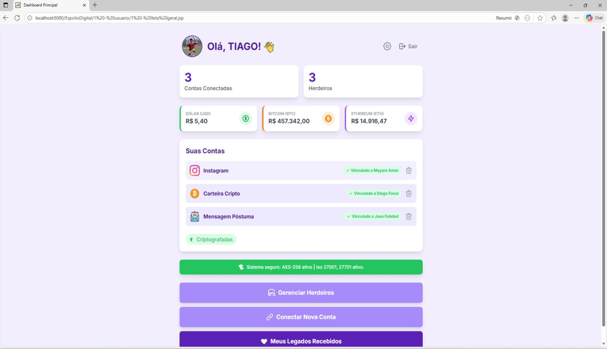
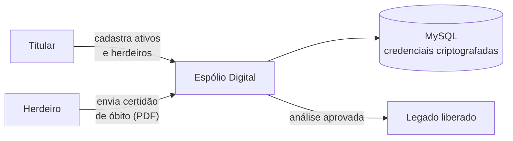
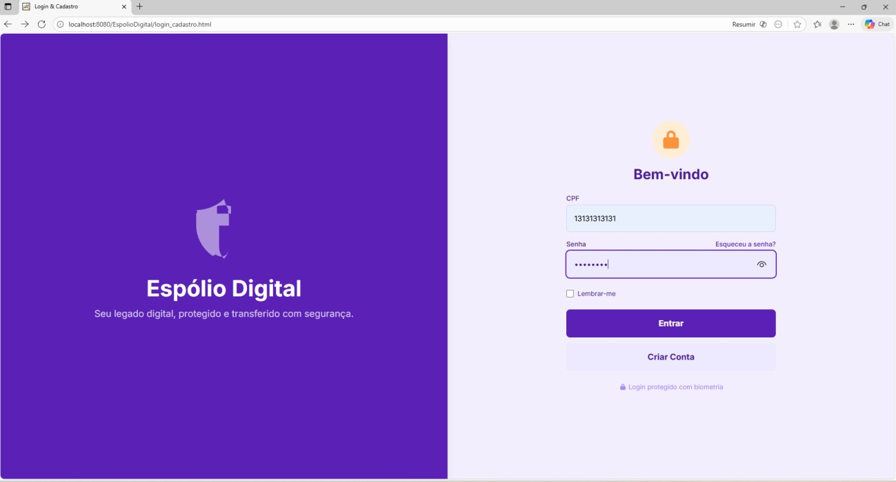
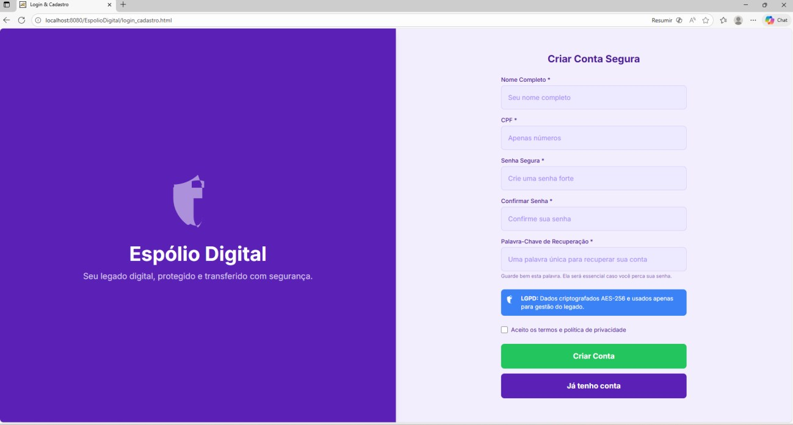
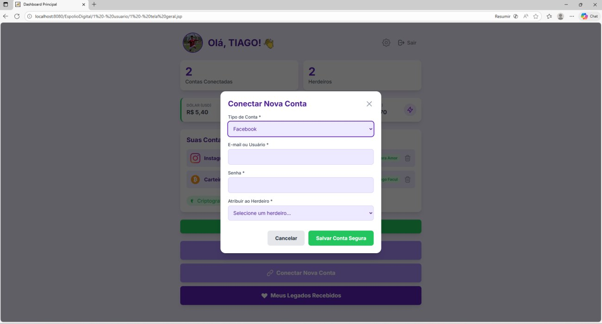
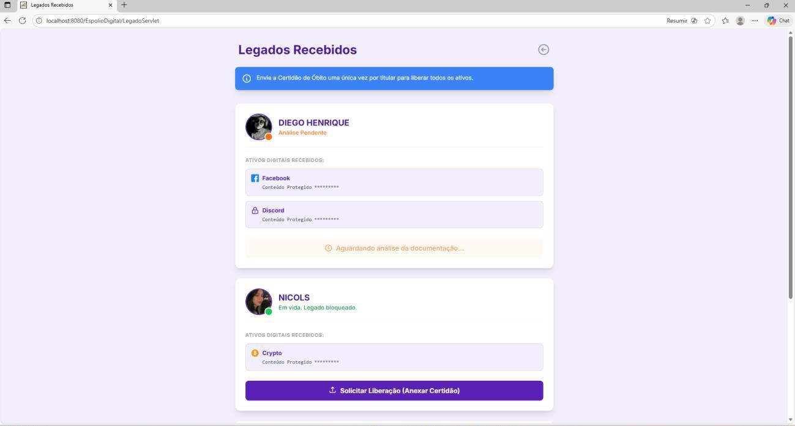
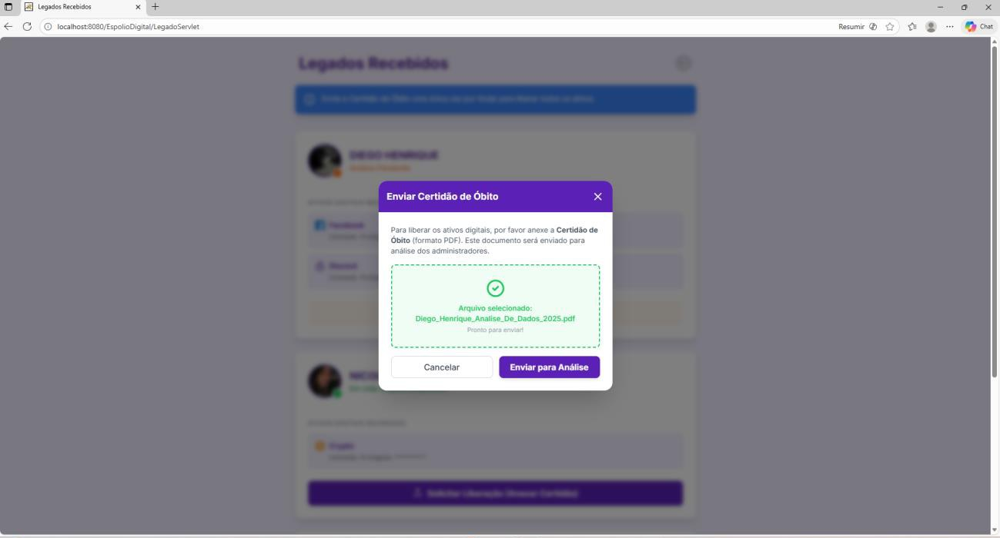
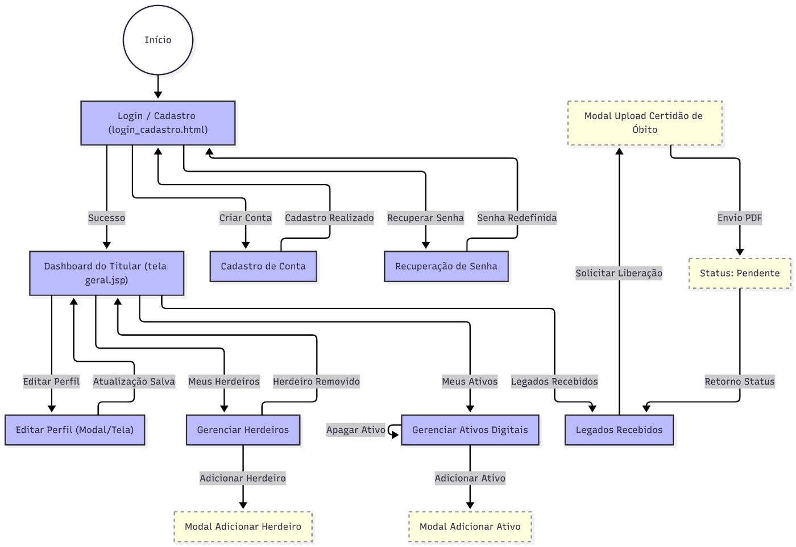

<h1 align="center">Espólio Digital</h1>

  <b>Seu legado digital, protegido e transferido com segurança.</b>

  
  
  
  
  

  

> **Sobre este repositório:** esta é a vitrine do projeto, com descrição, arquitetura e telas.
> O código-fonte é privado. Posso apresentá-lo em entrevista.

---

## O problema

Redes sociais, carteiras de criptomoedas e contas online fazem parte do patrimônio de qualquer pessoa,
mas quase ninguém deixa instruções sobre o que fazer com eles depois da morte. As credenciais se perdem
e os herdeiros ficam sem acesso.

## A solução

Um sistema web em que o **titular** cadastra seus ativos digitais e mensagens póstumas e escolhe **herdeiros**.
Os dados ficam **criptografados e bloqueados**. Para liberar, o herdeiro envia a **certidão de óbito em PDF**,
que passa por análise, e só então recebe o legado.

## Funcionalidades

- **Cadastro e login** com senha em hash SHA-256 e recuperação por palavra-chave
- **Ativos digitais:** Instagram, Facebook, Twitter, Discord, carteiras cripto (frases-chave) e mensagens póstumas
- **Criptografia AES** das credenciais guardadas no banco
- **Gestão de herdeiros** vinculados por CPF, com aviso quando o herdeiro ainda não tem cadastro
- **Legados recebidos:** o herdeiro vê o que foi deixado para ele, ainda bloqueado
- **Solicitação de liberação** com upload da certidão de óbito em PDF e status de análise
- **Editar perfil** com foto

## Telas

<table>
  <tr>
    <td></td>
    <td></td>
  </tr>
  <tr>
    <td align="center">Login</td>
    <td align="center">Cadastro com aviso de LGPD</td>
  </tr>
  <tr>
    <td></td>
    <td></td>
  </tr>
  <tr>
    <td align="center">Conectar um ativo e escolher o herdeiro</td>
    <td align="center">Legados recebidos (bloqueados)</td>
  </tr>
  <tr>
    <td></td>
    <td></td>
  </tr>
  <tr>
    <td align="center">Envio da certidão de óbito</td>
    <td align="center">Mapa de navegação do sistema</td>
  </tr>
</table>

As telas usam dados de teste.

## Tecnologias e decisões técnicas

| Camada | Tecnologia |
|---|---|
| Back-end | Java com Servlets, organizado em MVC e camada DAO |
| Front-end | JSP, HTML, CSS e JavaScript |
| Banco de dados | MySQL, com modelagem entidade-relacionamento e script SQL próprio |
| Segurança | Senhas em hash SHA-256 e credenciais criptografadas com AES |
| Ferramentas | NetBeans, Apache Tomcat, Git/GitHub |

## Equipe

Projeto final do curso de Análise e Desenvolvimento de Sistemas da Universidade de Mogi das Cruzes (2025),
feito em grupo com [@diegohenrique-data](https://github.com/diegohenrique-data) e
[@NicolyMartineli](https://github.com/NicolyMartineli).

---

  <a href="https://www.linkedin.com/in/tiago-mello-duran/">LinkedIn</a> ·
  <a href="https://github.com/tiagomello06">GitHub</a>

